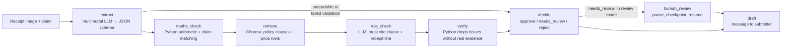
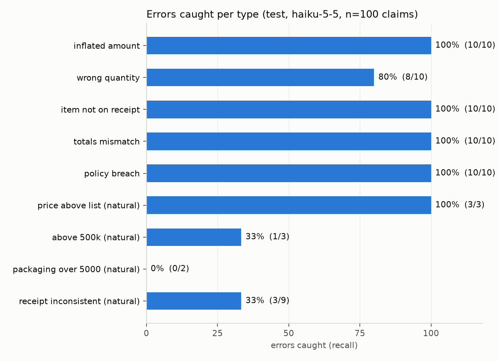
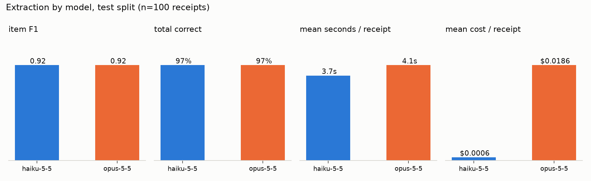

# Receipted

An AI agent that reads receipt and invoice images, checks them against a claim record, a price list and a policy document, flags problems with cited evidence, and drafts a reply to the submitter.

**Live demo:** https://receipted.streamlit.app · **Stack:** Python, Claude API (Haiku 5.5 / Opus 5.5), LangGraph, Chroma, Streamlit, pytest

**At a glance** (test split, 100 real receipts, 100 synthetic claims; every number from `results/`):

| | |
|---|---|
| Planted errors caught | **48 / 50** (95% CI in the results table) |
| Decision accuracy | 83% |
| Clean claims wrongly flagged | 8 / 41 (upper bound; several are real breaches the labels missed) |
| Item F1, Haiku 5.5 vs Opus 5.5 | 0.92 vs 0.92, at $0.0006 vs $0.0186 per receipt |
| Draft quality, Opus judge (1–5) | accuracy 4.6, evidence 4.89, clarity 4.73, tone 4.98 |
| Hallucination probe (total masked) | abstained on 9 / 10; the rest read a second printed copy |
| Cost and time per claim | $0.0013, 4.82 s |


## The problem

Finance teams, club treasurers and procurement staff check receipts and supplier bills by hand: does the claim match the receipt, do the numbers add up, is the price what we agreed, does it break a policy rule? It is slow, and mistakes slip through. Off-the-shelf tools read invoices well, but a team's own price list and policy are where the checking errors happen, and small teams don't pay for enterprise software.

A multimodal Claude model extracts line items and totals from the image. Plain Python then does the arithmetic checks, because code is exact and language models are not. Relevant policy clauses and price-list rows are retrieved from a local Chroma store, an LLM rule check must cite a clause and a receipt line for every issue it raises, and a verifier drops any issue whose evidence does not exist. The agent decides approve / needs_review / reject, sends unreadable documents to a human, and is measured on extraction accuracy, errors caught, false alarms, latency and cost.

## How it works



- **Each job goes to the right tool.** The image model reads the messy photo. Plain Python does the arithmetic, because language models are unreliable at maths and code is exact. Chroma finds the policy clauses and price rows that matter. The rule-check model may raise an issue only if it cites a clause and a receipt line.
- **Every flag needs evidence.** The verifier, in plain Python, throws away any issue whose clause id does not exist in the policy, whose receipt line is not in the extraction, or whose price comparison does not hold when re-done in code. Dropped issues are counted and reported.
- **It knows when to pass to a human.** Unreadable images and failed extractions skip the checks and go straight to *needs review*. Medium-severity findings also go to a person; only high-severity findings with evidence produce a reject.
- **It is measured, not just demoed.** See the results below. Every number comes from a file in `results/` written by the scripts in `eval/`.

### Human in the loop

Run a claim with `--review` and a needs_review decision pauses the graph instead of ending it: LangGraph checkpoints the whole state to SQLite under the claim id and stops before the draft. A reviewer lists what is waiting, decides, and the graph resumes from the checkpoint and writes the draft from the human's decision and note:

```bash
python -m receipted.run --sample SAMPLE-003 --review          # pauses: hot tea above the price list
python -m receipted.review list                                # what is waiting, with issues and evidence
python -m receipted.review resolve SAMPLE-003 approve "Cafe confirmed the price; one-off"
```

## How to run

```bash
git clone https://github.com/codedbygermaine/receipted && cd receipted
python3 -m venv .venv && .venv/bin/pip install -r requirements.txt && .venv/bin/pip install -e .
cp .env.example .env            # then put your ANTHROPIC_API_KEY in .env
.venv/bin/python data/prepare.py          # downloads CORD v2 (~2 GB) and writes data/images + data/gt
.venv/bin/python -m receipted.run --sample SAMPLE-002        # one claim, end to end
.venv/bin/streamlit run app/streamlit_app.py                 # the demo
.venv/bin/pytest                                             # 63 tests
```

Reproduce the evaluation (test split, prompts frozen; each script prints a cost estimate first):

```bash
.venv/bin/python eval/make_claims.py --split test
.venv/bin/python eval/eval_extraction.py --split test --model claude-haiku-5-5 --yes
.venv/bin/python eval/eval_extraction.py --split test --model claude-opus-5-5 --yes
.venv/bin/python eval/eval_checks.py --split test --yes
.venv/bin/python eval/eval_drafts.py --split test --yes
.venv/bin/python eval/report.py --split test
```

Every LLM response is cached on disk (keyed by input, prompt version and model), so re-runs are free.

<!-- RESULTS -->
## Results (test split)

### Extraction vs CORD ground truth

| model | receipts | item F1 (95% CI) | item precision | item recall | total correct | subtotal correct | tax correct | mean latency | mean cost / receipt |
|---|---|---|---|---|---|---|---|---|---|
| `claude-haiku-5-5` | 100 | 0.92 (0.87–0.95) | 0.88 | 0.95 | 97% | 96% | 97% | 3.68s | $0.0006 |
| `claude-opus-5-5` | 100 | 0.92 (0.88–0.95) | 0.88 | 0.95 | 97% | 98% | 100% | 4.13s | $0.0186 |

### Checks: full agent on 100 synthetic claims (`claude-haiku-5-5`)

| planted error | n | caught | recall (95% CI) |
|---|---|---|---|
| inflated amount | 10 | 10 | 100% (95% CI 100–100%) |
| wrong quantity | 10 | 8 | 80% (95% CI 50–100%) |
| item not on receipt | 10 | 10 | 100% (95% CI 100–100%) |
| totals mismatch | 10 | 10 | 100% (95% CI 100–100%) |
| policy breach | 10 | 10 | 100% (95% CI 100–100%) |
| **all planted errors** | 50 | 48 | **96% (95% CI 90–100%)** |

| natural breach (from ground truth) | n | caught | recall |
|---|---|---|---|
| price above list | 3 | 3 | 100% |
| above 500k | 3 | 1 | 33% |
| packaging over 5000 | 2 | 0 | 0% |
| receipt inconsistent | 9 | 3 | 33% |

| metric | value |
|---|---|
| decision accuracy (approve / needs_review / reject) | 83% (95% CI 76–90%) |
| clean claims (no planted error, no natural breach) | 41 |
| false alarms: clean claim flagged with an issue | 8 (20% (95% CI 7–32%)) |
| clean claims held only because the receipt was hard to read | 6 |
| rule-check issues raised / dropped by verifier | 48 / 4 |
| mean cost per claim | $0.0013 |
| mean seconds per claim (uncached) | 4.82 |

### Run 1 vs run 2 (same test claims, before and after the fixes from the error analysis)

| metric | run 1 | run 2 |
|---|---|---|
| planted errors caught | 47/50 | 48/50 |
| decision accuracy | 81% | 83% |
| false alarms (clean claims flagged) | 10/41 | 8/41 |
| rule-check issues dropped by verifier | 1 | 4 |
| mean cost per claim | $0.0013 | $0.0013 |

Run 2 is reported because the three fixes were motivated by failures seen in run 1; both are kept so the effect is visible and the second run is not mistaken for a first.

### Drafts: LLM-as-judge (`claude-opus-5-5` scoring `claude-haiku-5-5` drafts, 1–5)

| accuracy | evidence | clarity | tone | drafts with accuracy < 4 |
|---|---|---|---|---|
| 4.6 | 4.89 | 4.73 | 4.98 | 4 / 100 |

_Human scoring sheet generated; agreement will be reported once it is filled in._




<!-- /RESULTS -->

The headline (run 2): **48 of 50 planted errors caught (96%, 95% CI 90–100%)**, decision accuracy 83% on 100 claims, 8 of 41 clean claims flagged, at about $0.0013 and 5 seconds per claim with Haiku 5.5. Intervals are bootstrap 95% CIs over the 100 claims; with a test set this size a single percentage overstates what is known, so every headline carries one.

### Hallucination probe

Does the model invent a total when there is none? Using CORD's word coordinates, `eval/hallucination_probe.py` paints a white box over the printed total on real receipts and extracts again. On 10 validation receipts the model returned `null` for 9; on the tenth the receipt prints the same amount twice (an ITEMS line and a TOTAL line) and the model read the other copy, which is correct, not invented. Result file: `results/hallucination_probe_validation_claude-haiku-5-5.json`.

### Duplicate receipts

Policy clause C9 forbids claiming the same receipt twice. `src/receipted/duplicates.py` keeps a local registry of claims the CLI, app or MCP tool approved or held (image fingerprint, receipt total, item names). A new claim with the same fingerprint, or a different photo with the same total and 80%+ of the same item names, is rejected under C9 with the earlier claim id as evidence. Rejected claims are not registered, so a corrected resubmission goes through. Evaluation runs never write to the registry.

### Per-item confidence and what it saved

Since the test run, extraction (prompt v3) returns a confidence of high / medium / low for every item and for the total, and a claim is held for a person only when a line that matters was read with low confidence, not whenever the photo is partly blurry. Measured on the validation split (`results/confidence_routing_validation.json`), not the test split, because the test numbers above were frozen at prompt v2:

| validation, 100 claims, prompt v3 | |
|---|---|
| planted errors caught | 50 / 50 |
| decision accuracy | 90% |
| receipts marked "partly unclear" | 10 / 100 |
| clean claims held for readability, old rule → new rule | 2 → 1 |

Honest reading: the per-line rule saved one review here; most of the gain came from the prompt telling the model that blur on a logo or footer does not lower the confidence of a legible price line. The test split (prompt v2) had 25 receipts marked partly unclear and 6 clean claims held for that reason, so the saving there would be larger, but it has not been measured on test and is not claimed.

### Regression gate

`eval/compare.py` lines up two runs claim by claim, lists every decision that changed (FIXED / BROKE / moved), prints the headline metrics side by side and exits non-zero if recall or decision accuracy fell or false alarms rose. The run-1 vs run-2 table above comes from it. The two models read receipts equally well; Haiku costs 30× less. The human-scoring sheet for 10 drafts is in `results/human_scoring_sheet_test.md`; agreement with the judge is reported once it is filled in.

## Error analysis

The five worst real failures, with image ids and causes, are in [results/error_analysis.md](results/error_analysis.md). In short:

1. **A false reject from a name with no spaces** (`SATE ATI GO` vs the printed `SATECATIGO`): the fuzzy matcher depends on token boundaries. Fix: compare with spaces stripped too.
2. **A price-list row matched to the wrong product** (a 230,000 cake vs `almond cream cheese`): the verifier checks that the row exists and the arithmetic holds, not that it is the same product. Largest source of false alarms. Fix: a name-similarity guard in the verifier.
3. **A missing purpose that went unflagged** on 1 of 10 claims: a model applies a rule most of the time, not every time. Fix: a one-line deterministic check.
4. **A missed tax line turned into a false alarm**: the human-review route caught it, at the cost of a reviewer's look.
5. **A wrong quantity caught only as "claim exceeds receipt"**: right decision, incomplete explanation, because the item's quantity or name did not match.

Reading the 10 flagged clean claims by hand, at least 3 are correct by the policy as written and were missed by the synthetic labels (a women's blouse under C6, a dinner above the per-person cap, `Teh Es` above the `es teh` row). The 24% false-alarm figure is therefore an upper bound; the genuinely wrong flags are closer to 4 or 5 of 41.

## Limitations

- **The claims, price list, policy and planted errors are synthetic.** Built by me, on top of real CORD images, and labelled as such throughout. The planted error types are the ones I thought of.
- **Indonesian receipts only.** CORD has no store name or date fields, so the deadline clause (C11) is not checked and duplicates cannot be detected.
- **Ground truth is imperfect.** Some CORD labels disagree with what the receipt prints (word order, zero-priced lines, "Sub Total" as total), so part of the measured extraction error is label noise.
- **One bug was fixed during the test run.** The claim-lines check mis-flagged clean claims whose items were listed before tax; found on the first 17 test claims, fixed, run restarted. The partial first run is kept in `results/checks_test_run1_partial.log`.
- **The judge is a model.** Opus scores Haiku's drafts against a rubric; the human-agreement number exists to check the judge.

## What I'd do next

Done since the first test run: the name-similarity guard, space-insensitive matching, the deterministic purpose check (together: run 2 above), duplicate-receipt detection, the hallucination probe, confidence intervals, the regression gate and the MCP server. Still open:

1. Per-item confidence and quoted evidence in the extraction schema, so only uncertain items go to a human; measure how many of the 25% "partly unclear" holds that saves.
2. Pause-and-resume for human review using LangGraph checkpoints, with a small reviewer CLI, instead of stopping at needs_review.
3. Route receipts Haiku marks "partly unclear" to Opus and measure the trade-off.
4. Move the two-approver threshold (C7) into a deterministic check; the rule check raised it on only 1 of 3 claims.
5. Singapore receipts photographed by me, with an SGD policy and price list, to test a second country's format.

## Use from Claude Desktop (MCP)

Receipted is also an MCP server, so Claude Desktop can call it as a tool. Add this to `claude_desktop_config.json` (Settings → Developer → Edit Config), with your own absolute paths, then restart Claude Desktop:

```json
{
  "mcpServers": {
    "receipted": {
      "command": "/Users/you/receipted/.venv/bin/python",
      "args": ["-m", "receipted.mcp_server"],
      "cwd": "/Users/you/receipted"
    }
  }
}
```

Then ask Claude something like *"Check /Users/you/receipt.jpg against a claim of 250,000 IDR for a committee dinner, 4 people, items: Sop Sui Jiao 1 × 33,000 …"* and it will call `check_document` and get back the decision, the verified issues with evidence and the draft message. To test the server without Claude Desktop:

```bash
.venv/bin/python scripts/mcp_client_test.py SAMPLE-002
```

## Attribution and licence

Receipt images and ground truth: **CORD v2** (`naver-clova-ix/cord-v2`, [CC BY 4.0](https://creativecommons.org/licenses/by/4.0/)). Park, S. et al. "CORD: A Consolidated Receipt Dataset for Post-OCR Parsing", Document Intelligence Workshop at NeurIPS 2019. The five demo sample images in `app/samples/` are from the same dataset.

The claim records, price list, policy document and planted errors are **synthetic test fixtures** created for this project on top of the real CORD images, and are labelled as synthetic wherever they appear. Everything else in this repository is by Germaine Koh. Built with Claude Code.
