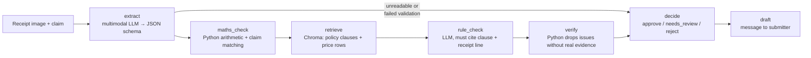

# Receipted

An AI agent that reads receipt and invoice images, checks them against a claim record, a price list and a policy document, flags problems with cited evidence, and drafts a reply to the submitter.

A multimodal Claude model extracts line items and totals from the image. Plain Python then does the arithmetic checks, because code is exact and language models are not. Relevant policy clauses and price-list rows are retrieved from a local Chroma store, an LLM rule check must cite a clause and a receipt line for every issue it raises, and a verifier drops any issue whose evidence does not exist. The agent decides approve / needs_review / reject, sends unreadable documents to a human, and is measured on extraction accuracy, errors caught, false alarms, latency and cost.

## Data and attribution

Receipt images and ground-truth line items come from **CORD v2** (`naver-clova-ix/cord-v2` on Hugging Face), licensed under [CC BY 4.0](https://creativecommons.org/licenses/by/4.0/). Park et al., "CORD: A Consolidated Receipt Dataset for Post-OCR Parsing", 2019.

The claim records, price list, policy document and planted errors used for evaluation are **synthetic test fixtures** created for this project, built on top of the real CORD receipt images. They are labelled as synthetic wherever they appear.

## How it works



Run one claim from the command line:

```bash
python -m receipted.run --sample SAMPLE-002
python -m receipted.run --image path/to/receipt.jpg --claim path/to/claim.json --model claude-opus-5-5
```

## Status

Phases 0–4 done: data, extraction, checks, agent graph and CLI. Evaluation, demo and full README to come.
