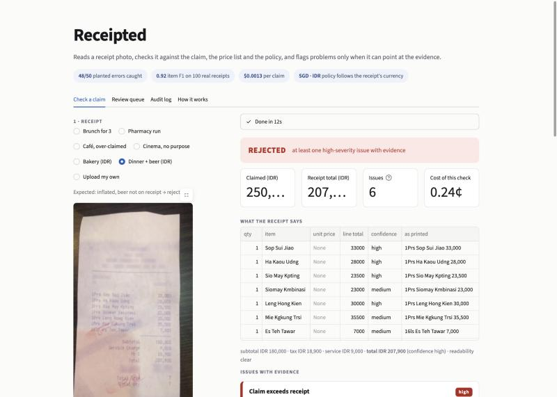
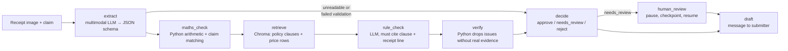

# Receipted

An AI expense reviewer that shows its working. It checks an expense claim against a receipt photo, a price list and a written policy, flags a problem only when it can point at the receipt line and the rule, sends uncertain cases to a human approver, and writes the reply.

**Try it:** https://codedbygermaine.github.io/receipted/ · **Case study:** [docs/case-study.md](docs/case-study.md) · **Stack:** Python, Claude API (Haiku 5.5 / Opus 5.5), LangGraph, Chroma, FastAPI on AWS Lambda, React + shadcn/ui, pytest, GitHub Actions



## At a glance

Test split: 100 real receipts (CORD v2), 100 test claims I wrote with known planted errors. Every number comes from a file in `results/` written by a script in `eval/`; the full tables, intervals and both test runs are in [docs/evaluation.md](docs/evaluation.md).

| | |
|---|---|
| Planted errors caught | **48 / 50** (95% CI 87–99%) |
| Decision accuracy | 83% |
| Clean claims wrongly flagged | 8 / 41, an upper bound: at least 3 of them are real breaches my labels missed |
| Item F1, Haiku 5.5 vs Opus 5.5 | 0.92 vs 0.92, at $0.0006 vs $0.0186 per receipt |
| Draft quality, Opus judge (1–5) | accuracy 4.6, evidence 4.89, clarity 4.73, tone 4.98; a human agreed within 1 point on 39 of 40 scores |
| Hallucination probe, total masked on 98 receipts | 84% abstained, 0 fabricated digits |
| Cost and time per claim | $0.0013, 4.82 s |

## How it works



- **Each job goes to the right tool.** The image model reads the messy photo. Plain Python does the arithmetic, because code is exact and models are not. Chroma finds the policy clauses and price rows that matter, for the receipt's currency.
- **Every flag needs evidence.** The rule-check model may raise an issue only if it cites a clause and a receipt line. A verifier in plain Python drops any issue whose clause does not exist, whose line is not in the extraction, or whose price comparison does not hold when redone in code. Dropped issues are counted.
- **It knows when to pass to a person.** Unreadable images go straight to review. Medium-severity findings are held for an approver; only high-severity findings with evidence produce a reject. A held claim pauses the LangGraph run at a checkpoint and resumes from the approver's decision.
- **It borrows the practices of production systems.** Votes on the model's judgement for large claims, confidence calibrated on real documents, an audit record for every decision, reviewer corrections kept as labelled cases, card numbers masked in code, a regression gate in CI. Details and sources in [docs/production.md](docs/production.md).

## Run it

```bash
git clone https://github.com/codedbygermaine/receipted && cd receipted
python3 -m venv .venv && .venv/bin/pip install -r requirements.txt && .venv/bin/pip install -e .
cp .env.example .env                                  # put your ANTHROPIC_API_KEY in .env
.venv/bin/python data/prepare.py                      # downloads CORD v2 (~2 GB)
.venv/bin/python -m receipted.run --sample SAMPLE-002 # one claim, end to end
.venv/bin/pytest                                      # 86 tests
```

To reproduce the evaluation, run the scripts in `eval/` in the order listed in [docs/evaluation.md](docs/evaluation.md); each prints a cost estimate first, and every model response is cached so re-runs are free. The web demo (`web/`), the HTTP API on AWS Lambda (`api/`) and the MCP server for Claude Desktop are described in [docs/integrations.md](docs/integrations.md).

## What went wrong, honestly

The five worst failures, with image ids and causes, are in [results/error_analysis.md](results/error_analysis.md): a fuzzy matcher that depended on spaces, a price row matched to the wrong product, a rule the model applied nine times out of ten. One bug was fixed during the test run (found on the first 17 claims, disclosed, the partial log kept). The judge is a model, so a human scored a sample to check it. The claims, price list, policy and planted errors were written by me for testing; the receipts are real. Dates are not checked, because the dataset has none. The learning log of every phase, with the trade-offs and the interview questions each one raised, is [LEARNING.md](LEARNING.md).

## Attribution and licence

Receipt images and ground truth: **CORD v2** (`naver-clova-ix/cord-v2`, [CC BY 4.0](https://creativecommons.org/licenses/by/4.0/)). Park, S. et al. "CORD: A Consolidated Receipt Dataset for Post-OCR Parsing", Document Intelligence Workshop at NeurIPS 2019. Ten further receipts are from Wikimedia Commons under the licences listed in [docs/evaluation.md](docs/evaluation.md); the Singapore receipts are my own. The claim records, price lists, policies and planted errors were **written by me for testing**, on top of the real images; the files say so in their headers. Everything else in this repository is by Germaine Koh. Built with Claude Code.
