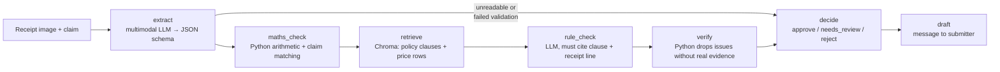

# Receipted

An AI agent that reads receipt and invoice images, checks them against a claim record, a price list and a policy document, flags problems with cited evidence, and drafts a reply to the submitter.

**Live demo:** _coming in Phase 6_ · **Stack:** Python, Claude API (Haiku 5.5 / Opus 5.5), LangGraph, Chroma, Streamlit, pytest


## The problem

Finance teams, club treasurers and procurement staff check receipts and supplier bills by hand: does the claim match the receipt, do the numbers add up, is the price what we agreed, does it break a policy rule? It is slow, and mistakes slip through. Off-the-shelf tools read invoices well, but a team's own price list and policy are where the checking errors happen, and small teams don't pay for enterprise software.

A multimodal Claude model extracts line items and totals from the image. Plain Python then does the arithmetic checks, because code is exact and language models are not. Relevant policy clauses and price-list rows are retrieved from a local Chroma store, an LLM rule check must cite a clause and a receipt line for every issue it raises, and a verifier drops any issue whose evidence does not exist. The agent decides approve / needs_review / reject, sends unreadable documents to a human, and is measured on extraction accuracy, errors caught, false alarms, latency and cost.

## Data and attribution

Receipt images and ground-truth line items come from **CORD v2** (`naver-clova-ix/cord-v2` on Hugging Face), licensed under [CC BY 4.0](https://creativecommons.org/licenses/by/4.0/). Park et al., "CORD: A Consolidated Receipt Dataset for Post-OCR Parsing", 2019.

The claim records, price list, policy document and planted errors used for evaluation are **synthetic test fixtures** created for this project, built on top of the real CORD receipt images. They are labelled as synthetic wherever they appear.

## How it works



- **Each job goes to the right tool.** The image model reads the messy photo. Plain Python does the arithmetic, because language models are unreliable at maths and code is exact. Chroma finds the policy clauses and price rows that matter. The rule-check model may raise an issue only if it cites a clause and a receipt line.
- **Every flag needs evidence.** The verifier, in plain Python, throws away any issue whose clause id does not exist in the policy, whose receipt line is not in the extraction, or whose price comparison does not hold when re-done in code. Dropped issues are counted and reported.
- **It knows when to pass to a human.** Unreadable images and failed extractions skip the checks and go straight to *needs review*. Medium-severity findings also go to a person; only high-severity findings with evidence produce a reject.
- **It is measured, not just demoed.** See the results below. Every number comes from a file in `results/` written by the scripts in `eval/`.

## How to run

```bash
git clone https://github.com/codedbygermaine/receipted && cd receipted
python3 -m venv .venv && .venv/bin/pip install -r requirements.txt && .venv/bin/pip install -e .
cp .env.example .env            # then put your ANTHROPIC_API_KEY in .env
.venv/bin/python data/prepare.py          # downloads CORD v2 (~2 GB) and writes data/images + data/gt
.venv/bin/python -m receipted.run --sample SAMPLE-002        # one claim, end to end
.venv/bin/streamlit run app/streamlit_app.py                 # the demo
.venv/bin/pytest                                             # 63 tests
```

Reproduce the evaluation (test split, prompts frozen; each script prints a cost estimate first):

```bash
.venv/bin/python eval/make_claims.py --split test
.venv/bin/python eval/eval_extraction.py --split test --model claude-haiku-5-5 --yes
.venv/bin/python eval/eval_extraction.py --split test --model claude-opus-5-5 --yes
.venv/bin/python eval/eval_checks.py --split test --yes
.venv/bin/python eval/eval_drafts.py --split test --yes
.venv/bin/python eval/report.py --split test
```

Every LLM response is cached on disk (keyed by input, prompt version and model), so re-runs are free.

<!-- RESULTS -->
